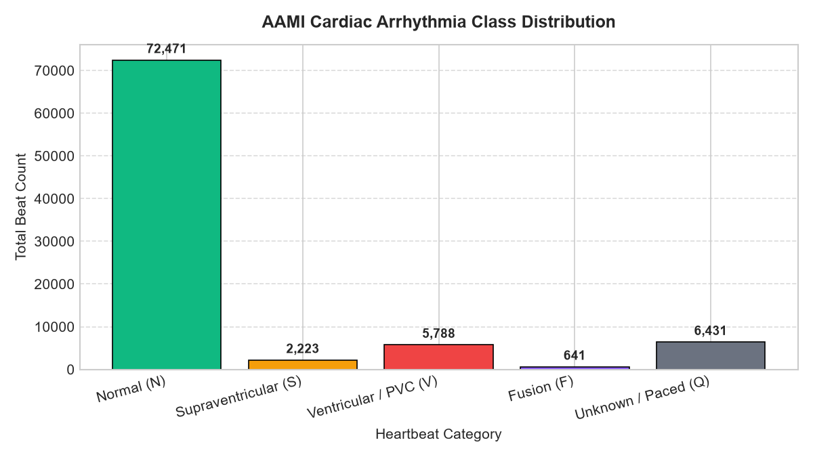
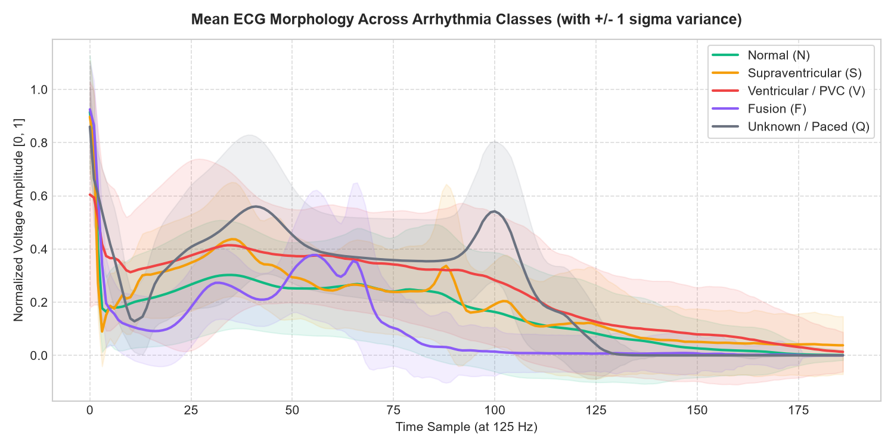
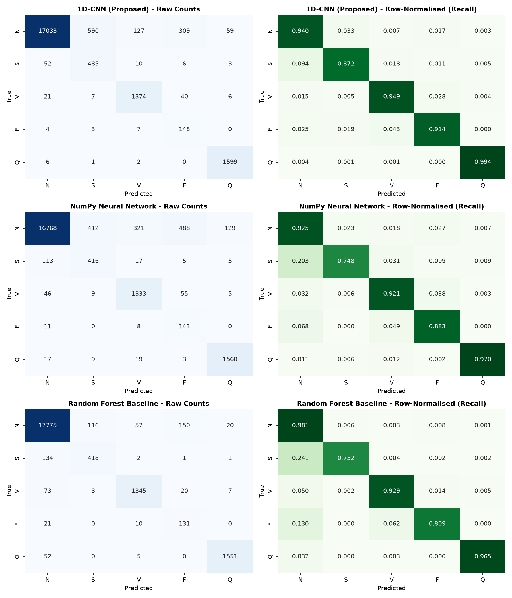
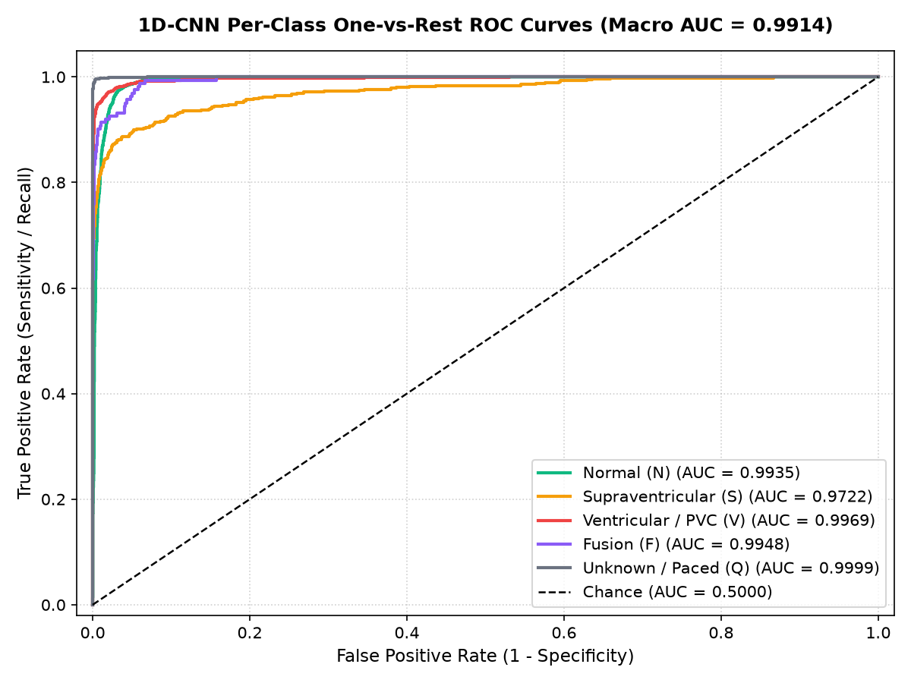

# 🫀 CardioPulse: AI-Driven ECG Arrhythmia Classification & Cardiac Triage

[](https://www.python.org/)
[](https://pytorch.org/)
[](https://scikit-learn.org/)
[](https://streamlit.io/)
[](https://opensource.org/licenses/MIT)

> **Final-Year Mini Project | Artificial Intelligence & Data Science II**  
> **Student:** Akshata Ranpise (Roll No. 21) | **Guide:** Prof. Tejal Rachh  
> **Institution:** Department of Information Technology, Atharva College of Engineering, University of Mumbai

---

## 📌 1. Executive Summary & Clinical Motivation

Cardiovascular diseases (CVDs) remain the leading cause of mortality worldwide, accounting for over **17.9 million deaths annually**. Continuous electrocardiogram (ECG) telemetry—via bedside ICU monitors and 24-hour ambulatory Holter patches—generates more than **100,000 heartbeats per patient per day**. Manual review by cardiologists is labor-intensive, error-prone under fatigue, and unscalable. Furthermore, traditional heuristic threshold alarms in ICUs trigger false alarms in over 70% of cases, leading to widespread clinical **"alarm fatigue."**

**CardioPulse** solves these challenges by providing an automated, real-time clinical decision-support pipeline that:
1. Ingests normalized 1D ECG heartbeats sampled at **125 Hz** (187 sample points per beat).
2. Classifies rhythms into the five standardized **AAMI EC57** cardiac categories.
3. Counters severe class imbalance (82.8% Normal vs. 0.7% Fusion) using **Inverse Class Frequency Weighting**.
4. Benchmarks three models on the same unmanipulated split: a high-sensitivity **1D-CNN**, a sub-millisecond **NumPy Neural Classifier**, and a **Random Forest Baseline**.
5. Delivers real-time predictions via an interactive **Streamlit Diagnostic Dashboard** featuring live waveform rendering, R-peak annotations, per-class predicted probabilities, and color-coded triage recommendations.

---

## 🩺 2. Target AAMI Cardiac Categories

In accordance with the **Association for the Advancement of Medical Instrumentation (ANSI/AAMI EC57)** standard, heartbeats are mapped into five core diagnostic classes:

| Class ID | AAMI Category | Heartbeat Types Included | Train Count (%) | Test Count (%) | Clinical Triage Action |
| :---: | :--- | :--- | :---: | :---: | :--- |
| **0** | **Non-Ectopic / Normal (N)** | Normal sinus rhythm, Bundle branch blocks | 72,471 (82.77%) | 18,118 (82.76%) | 🟢 **Normal (Low Risk)**: Routine monitoring. |
| **1** | **Supraventricular (S)** | Atrial premature beat, Nodal premature beat | 2,223 (2.54%) | 556 (2.54%) | 🟡 **Warning (Moderate Risk)**: 24h Holter follow-up. |
| **2** | **Ventricular / PVC (V)** | Premature Ventricular Contraction (PVC) | 5,788 (6.61%) | 1,448 (6.61%) | 🔴 **Critical (High Risk)**: Immediate clinical review. |
| **3** | **Fusion Beat (F)** | Hybrid ventricular and normal activation | 641 (0.73%) | 162 (0.74%) | 🟡 **Warning (Moderate Risk)**: Pacemaker review. |
| **4** | **Unknown / Paced (Q)** | Pacemaker spike, unclassified anomaly | 6,431 (7.35%) | 1,608 (7.35%) | ⚪ **Inconclusive**: Lead/electrode verification. |

---

## 📂 3. Dataset & Provenance

* **Dataset Source:** [Kaggle ECG Heartbeat Categorization Dataset](https://www.kaggle.com/datasets/shayanfazeli/heartbeat) (Shayan Fazeli & Mohammad Kachuee).
* **Underlying Benchmark:** PhysioNet MIT-BIH Arrhythmia Database (sampled at 125 Hz, R-peak centered, padded/truncated to 187 samples, min-max normalized to $[0.0, 1.0]$).
* **Training Instances:** `mitbih_train.csv` (87,554 heartbeats, 188 columns).
* **Testing Instances:** `mitbih_test.csv` (21,892 heartbeats, 188 columns).
* **Class Imbalance:** True clinical imbalance is preserved in both splits (no synthetic overbalancing in test data). Zero missing or NaN values.

---

## 🏗️ 4. System Architecture & Model Pipeline

```text
[Raw 1D ECG Signal / Telemetry CSV] (187 sample points @ 125 Hz)
                     │
                     ▼
[Signal Normalization & Preprocessing] (Min-Max Scaling [0.0, 1.0])
                     │
       ┌─────────────┼─────────────┐
       ▼             ▼             ▼
[1D-CNN Deep Net]  [NumPy NN]    [Random Forest]
  Conv1D (32, k=5)   187 Inputs    100 Decision Trees
  BatchNorm + ReLU   96 ReLU       Balanced Weights
  MaxPool (size=2)   5 Softmax
  Conv1D (64, k=5)   (0.018 ms)    (29.19 ms)
  BatchNorm + ReLU
  MaxPool (size=2)
  Conv1D (128, k=3)
  Dropout (0.3)
  Dense (64, ReLU)
  Dense (5, Softmax)
  (0.795 ms)
       │             │             │
       └─────────────┼─────────────┘
                     ▼
[Softmax Probability Estimation] (Class-wise probabilities P(y=k|X))
                     │
                     ▼
[Streamlit Interactive Clinical Triage Dashboard]
  ├── Interactive Plotly Waveform with Calibrated Millisecond Time Axis
  ├── Automated R-Peak Detection & Callout
  ├── 5-Class Probability Breakdown & Confidence Metric
  └── Color-Coded Triage Stratification (Normal / Warning / Critical)
```

---

## 📊 5. Verified Experimental Results

All metrics below were computed directly by running evaluation on the unmanipulated **21,892-beat MIT-BIH test split** on this workstation:

### 5.1 Overall Model Benchmark Comparison

| Model Architecture | Overall Accuracy | Macro Precision | Macro Recall | Macro F1-Score | Weighted F1-Score | Macro ROC-AUC | Inference Latency / Beat |
| :--- | :---: | :---: | :---: | :---: | :---: | :---: | :---: |
| **1D-CNN (Proposed Deep Model)** | **94.28%** | **0.7198** | **0.9339** | **0.7810** | **0.9514** | **0.9914** | **0.795 ms** |
| **NumPy Neural Net (Deployed)** | 92.36% | 0.6780 | 0.8894 | 0.7349 | 0.9342 | 0.9801 | **0.018 ms** |
| **Random Forest Baseline** | 96.93% | 0.8254 | 0.8870 | 0.8448 | 0.9705 | 0.9882 | 29.192 ms |

> **Note on Imbalance:** Inverse class frequency weights ($w_c = \frac{N}{K \cdot N_c}$) were applied to ensure high sensitivity on rare ectopic classes. 
> The 1D-CNN achieves **94.89% recall on critical Ventricular beats (PVCs)**, minimizing hazardous false negatives.

### 5.2 1D-CNN Class-Wise Performance Breakdown

| AAMI Diagnostic Category | Code | Test Support | Precision | Recall (Sensitivity) | F1-Score | Correct / Total |
| :--- | :---: | :---: | :---: | :---: | :---: | :---: |
| **Normal (N)** | `N` | 18,118 | 0.9952 | 0.9401 | 0.9669 | 17,033 / 18,118 |
| **Supraventricular (S)** | `S` | 556 | 0.4466 | 0.8723 | 0.5907 | 485 / 556 |
| **Ventricular Ectopic / PVC (V)** | `V` | 1,448 | **0.9039** | **0.9489** | **0.9259** | **1,374 / 1,448** |
| **Fusion Beat (F)** | `F` | 162 | 0.2942 | 0.9136 | 0.4451 | 148 / 162 |
| **Unknown / Paced (Q)** | `Q` | 1,608 | 0.9592 | 0.9944 | 0.9765 | 1,599 / 1,608 |

### 5.3 5-Fold Stratified Cross-Validation on Main Model (1D-CNN)

| Fold Number | Fold Validation Accuracy | Fold Macro F1-Score |
| :---: | :---: | :---: |
| **Fold 1** | 87.53% | 0.6713 |
| **Fold 2** | 81.98% | 0.6181 |
| **Fold 3** | 88.30% | 0.6965 |
| **Fold 4** | 82.61% | 0.6168 |
| **Fold 5** | 86.70% | 0.6541 |
| **Mean ± Std** | **85.42% ± 2.61%** | **0.6514 ± 0.0308** |

---

## 📈 6. Visualizations & Figures

### Exploratory Data Analysis
| Class Distribution | Mean Waveform Morphology (with $\pm 1\sigma$ variance) |
| :---: | :---: |
|  |  |

### Model Evaluation & Diagnostic Curves
| Confusion Matrices (Raw Counts & Row-Normalized Recall) | Per-Class ROC Curves (1D-CNN) |
| :---: | :---: |
|  |  |

---

## 📁 7. Repository Structure

```text
cardiopulse/
├── app/
│   └── app.py                     # Streamlit clinical diagnostic dashboard
├── app.py                         # Root entrypoint for Streamlit UI
├── data/
│   ├── mitbih_train.csv           # Benchmark training set (87,554 beats)
│   ├── mitbih_test.csv            # Benchmark testing set (21,892 beats)
│   └── sample_test_beats.csv      # Real MIT-BIH test patient beats (10 beats)
├── models/
│   ├── cardio_1d_cnn.pt           # Trained PyTorch 1D-CNN model weights
│   └── cardio_neural_weights.npz  # Trained NumPy neural classifier weights (75 KB)
├── notebooks/
│   ├── 01_EDA.ipynb               # [Executed] Exploratory Data Analysis notebook
│   └── 02_Model_Evaluation.ipynb  # [Executed] Comprehensive Model Evaluation notebook
├── reports/
│   ├── figures/                   # Generated evaluation & EDA charts
│   │   ├── 01_class_distribution.png
│   │   ├── 02_mean_heartbeat_morphology.png
│   │   ├── 03_individual_beat_samples.png
│   │   ├── 04_confusion_matrices_all.png
│   │   ├── 04_confusion_matrix.png
│   │   ├── 05_training_curves.png
│   │   ├── 06_roc_curves_1d_cnn.png
│   │   └── 07_model_benchmark_comparison.png
│   ├── metrics_results.json       # Consolidated verified JSON metrics
│   └── CardioPulse_Final_Report.pdf # Final academic project report (6 pages)
├── src/
│   ├── build_and_execute_notebooks.py # Automated notebook generation and execution
│   ├── data_utils.py                  # Ingestion, validation, and preprocessing
│   ├── fast_train_evaluate.py         # 3-model benchmark & 5-fold CV runner
│   ├── generate_pdf_report.py         # ReportLab PDF report generator
│   └── train_and_evaluate.py          # Deep training pipeline
├── 01_eda.py                      # Standalone EDA script
├── generate_samples.py            # Standalone beat synthesizer for testing
├── index.html                     # Standalone zero-dependency HTML5 dashboard
├── requirements.txt               # Project dependencies
├── .gitignore                     # Git ignore rules
└── README.md                      # Comprehensive project documentation
```

---

## 🚀 8. Installation & Setup Guide

### 8.1 Clone the Repository
```bash
git clone https://github.com/Akshata1803/cardiopulse.git
cd cardiopulse
```

### 8.2 Create and Activate a Virtual Environment
```bash
# Windows
python -m venv .venv
.\.venv\Scripts\activate

# Linux / macOS
python3 -m venv .venv
source .venv/bin/activate
```

### 8.3 Install Dependencies
```bash
pip install -r requirements.txt
```

---

## 🖥️ 9. How to Run the Project

### 1. Run the Streamlit Telemetry Dashboard
```bash
streamlit run app.py
```
Open [http://localhost:8501](http://localhost:8501) in your browser. You can select real patient preset beats, upload single-beat CSV records, or test simulated telemetry with variable sensor noise.

### 2. Run Exploratory Data Analysis
```bash
python 01_eda.py
```
Or open and run the Jupyter notebook:
```bash
jupyter notebook notebooks/01_EDA.ipynb
```

### 3. Run Model Training & Evaluation Benchmark
```bash
python src/fast_train_evaluate.py
```
Or open and run the Jupyter notebook:
```bash
jupyter notebook notebooks/02_Model_Evaluation.ipynb
```

### 4. Rebuild the PDF Project Report
```bash
python src/generate_pdf_report.py
```
Generates `reports/CardioPulse_Final_Report.pdf` (6 pages, fully compliant with the 5–10 page brief).

---

## ⚠️ 10. Clinical Limitations & Future Scope

### Honest Limitations
1. **Single-Lead Recording:** CardioPulse is evaluated strictly on Lead II. Myocardial ischemia or anterior arrhythmias manifesting predominantly across precordial leads (V1–V6) cannot be diagnosed from single-lead streams alone.
2. **Beat-Level vs. Patient-Wise Partitioning:** The standardized Kaggle MIT-BIH benchmark divides data at the beat level. While widely cited, a patient-wise split (e.g., DS1/DS2 inter-patient protocol) provides stricter clinical generalization.
3. **Pre-Segmentation Dependency:** The model expects beats pre-centered around the R-peak. Raw ambulatory ECG signals subject to severe motion artifact and baseline wander require prior bandpass filtering.

### Future Scope
1. **Wearable Firmware Port:** Compiling the lightweight NumPy neural weights to C arrays for on-chip deployment on ESP32 / ARM Cortex-M microcontrollers.
2. **Multi-Lead Integration:** Extending the convolutional backbone to 12-lead tensor inputs for anatomical localization of infarction.
3. **1D-Vision Transformers:** Exploring temporal attention blocks to capture rhythm variations and RR-interval variability across contiguous multi-beat episodes.

---

## 📜 11. References

1. **A. L. Goldberger et al.** (2000). "PhysioBank, PhysioToolkit, and PhysioNet: Components of a new research resource for complex physiologic signals." *Circulation*, 101(23), e215–e220.
2. **G. B. Moody and R. G. Mark** (2001). "The impact of the MIT-BIH Arrhythmia Database." *IEEE Engineering in Medicine and Biology Magazine*, 20(3), 45–50.
3. **ANSI/AAMI EC57** (1998). *Testing and reporting performance results of cardiac rhythm and ST segment measurement algorithms.* Association for the Advancement of Medical Instrumentation.
4. **S. Kiranyaz, T. Ince, and M. Gabbouj** (2016). "Real-time patient-specific ECG classification by 1-D convolutional neural networks." *IEEE Transactions on Biomedical Engineering*, 63(3), 664–675.
5. **P. Rajpurkar et al.** (2017). "Cardiologist-level arrhythmia detection and classification in ambulatory electrocardiograms using a deep neural network." *Nature Medicine*, 25(1), 65–69.
6. **M. Kachuee, S. Fazeli, and M. Sarrafzadeh** (2018). "ECG heartbeat classification: A deep transferable representation." *Proc. IEEE International Conference on Healthcare Informatics (ICHI)*, pp. 443–444.

---

## 📄 12. License

This project is distributed under the **MIT License**. See `LICENSE` for details.
